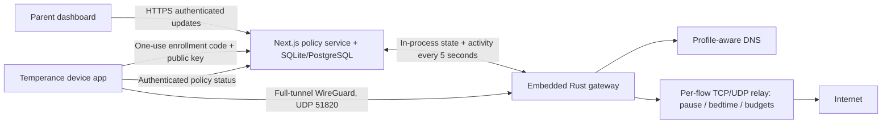

# VPN architecture and protocol



Temperance is one program: the Next.js policy service in `web/` with the WireGuard gateway (`core/temperance-gateway`) loaded as a native Node add-on. `web/src/instrumentation.ts` starts it when `TEMPERANCE_GATEWAY_LISTEN` is set, and `web/src/lib/gateway.ts` hands it the gateway state document and accounts its activity every 5 seconds. The same crate builds a standalone `temperance-gateway` CLI that speaks the `/v1/gateway/*` API to a service hosted elsewhere. The policy rules themselves live in `core/temperance-core`, shared with the device apps and checked against `specs/policy-cases.json` alongside the TypeScript implementation. Clients generate private keys locally; only public keys are enrolled. An administrator creates a random enrollment code for one profile. It expires after 10 minutes and is consumed atomically with enrollment. The response contains a scoped device token, assigned tunnel addresses, gateway public key, endpoint, policy version, and current policy. Device tokens are stored as hashes at the service. Codes and keys are never embedded in repository configuration.

An instance manages one household and one WireGuard gateway, with up to 253 lifetime IPv4 assignments. Revoked addresses are not reused. Deploy separate instances for separate households. Profile/device changes increment the monotonic policy version. Device tokens only read that device's state; gateway and administrator tokens have distinct privileges.

Parents sign in with a username and password. Passwords are never stored: each is a salted PBKDF2-HMAC-SHA256 hash (600,000 iterations, WebCrypto, so it runs on Node, Vercel, and Cloudflare). Ten consecutive failures lock an account for 15 minutes. Browser sessions and OAuth access tokens are the same HMAC-signed, one-hour token bound to the account's session version, so a password change or account removal revokes them; refresh tokens are random, stored only as SHA-256 hashes, and rotated on every use. The owner adds co-parents. `TEMPERANCE_ADMIN_TOKEN` creates the first owner and remains a bearer credential for automation. Deploy the control plane behind HTTPS; it does not implement its own certificate issuance.

The gateway runs WireGuard in userspace (boringtun) and terminates each peer's TCP and UDP flows in a userspace network stack, opening its own outbound sockets for allowed ones. It needs no root, TUN device, kernel module or firewall rules, so it runs the same way on Linux, macOS and Windows. A decrypted packet is accepted only when its source is the sending peer's own `/32`, which binds every tunnel address to one WireGuard key. Client routes capture IPv4 and IPv6, but the gateway drops IPv6 and every private/reserved destination (including other peers and your LAN). Its only local services are DNS on `10.77.0.1:53` and the dashboard at `http://10.77.0.1`.

Every flow is decided when it opens and decided again on every state update (at least every 5 seconds) and every 2 seconds in between. Pause, bedtime, Off Time, strict allow-lists and budget exhaustion therefore close existing connections as well as refusing new ones. Policy is held under a 15-second lease renewed by each state update: if the update loop stops, forwarding stops. The embedded gateway shares the service's process, so a service outage is a gateway outage. A standalone CLI that loses its service keeps enforcing its last policy within the parent-configured offline grace, with schedules evaluated live; budgets do not advance until the service is back, and buffered activity is reported then. Device revocation propagates on the next state update by removing the WireGuard peer.

Usage is **observed allowed network minutes**, not foreground screen time. The gateway records, per device and minute, the buckets (total, category, site, app group) of the destinations it carried traffic to, using the names it resolved for that device. The service counts each minute once per profile and bucket, even for simultaneous devices. Background traffic counts; handshakes, DNS and refused traffic do not. A reached budget closes traffic at the next state update.
The gateway answers DNS itself and forwards allowed queries upstream (`TEMPERANCE_GATEWAY_DNS_UPSTREAM`, default 1.1.1.1). DNS sent to any other resolver on port 53 is answered by the gateway as well, and port 853 (DNS-over-TLS) is refused. Domain filtering refuses names before forwarding; SafeSearch/YouTube restrictions answer with the restricted CNAME; starter category lists remain small. DNS over HTTPS, direct IP connections, shared CDNs, VPN/proxy overlays, and cached DNS can bypass domain/category filtering. **The implementation does not claim comprehensive web content filtering.** Pause/bedtime/budgets still deny entire connections even in these cases. The dashboard and VPN endpoint hostnames are exempt from policy so devices can reach their status and ask for more time while blocked.

Home-network devices are enforced in DNS mode (any OS: the gateway answers their DNS on the LAN) or Linux router mode, where the gateway manages its own `temperance_home` and `temperance_home_nat` nftables tables with the same 15-second lease, per-device counters, DNS redirection and masquerading of registered devices only. It never touches other firewall tables.

Network enforcement applies while devices route through this VPN. Preventing VPN removal, route changes, another VPN, and off-tunnel access requires OS-level administration: Android always-on lockdown/device owner; Apple managed-device restrictions; restricted desktop accounts and host firewall policy. The application alone cannot take ownership of an unmanaged personal device. Apple on-demand connection is automatic reconnection, not a supervised-device always-on guarantee. Linux's systemd tunnel starts at boot; Windows uses the WireGuard tunnel service. macOS/iOS use Network Extension; Android embeds the official GoBackend VPN service.

## API

All JSON writes are bounded to 64 KiB. Production URLs must use HTTPS. Clients verify the platform trust store and do not disable certificate checks.

| Method | Path | Credential | Purpose |
| --- | --- | --- | --- |
| GET | `/v1/setup` | None | `{needs_setup}` before the first owner exists |
| POST | `/v1/setup` | `TEMPERANCE_ADMIN_TOKEN` as `setup_token` + matching Origin | Create the owner account (once) |
| POST | `/v1/login` | Username + password + matching Origin | One-hour HttpOnly browser session |
| POST | `/v1/logout` | None | Clear the browser session |
| POST | `/v1/oauth/token` | `grant_type=password` (username/password) or `refresh_token` | OAuth 2.0 bearer access token (1 h) + rotating refresh token (30 d) |
| POST | `/v1/oauth/revoke` | Refresh token | Revoke a refresh token |
| GET | `/api/me`, `/api/users` | Parent | Current account; family administrators |
| POST | `/api/users`, `/api/users/delete` | Owner | Add / remove co-parents |
| POST | `/api/password` | Parent | Change own password (signs out other sessions) |
| GET | `/api/state` | Parent | Dashboard configuration and usage |
| POST | `/api/profiles` | Admin | Create/update policy, increment revision |
| POST | `/api/devices` | Admin | Assign/change device profile |
| POST | `/api/devices/delete` | Admin | Revoke enrolled peer and token, or remove a home-network device |
| POST | `/api/devices/home` | Admin | `{name,ip,profile_id}` → register a TV/console by its reserved LAN IPv4 |
| POST | `/api/devices/locate` | Admin | Ask a consenting device for its location once |
| POST | `/api/enrollment` | Admin | `{profile_id}` → short-lived one-use code |
| POST | `/v1/enroll` | Enrollment code | `{code,name,public_key}` → device token/state |
| GET | `/v1/device/state` | Device bearer | Its own policy and VPN provisioning |
| POST | `/v1/device/requests` | Device bearer | Ask parents for more time |
| POST | `/v1/device/location` | Device bearer | Answer a pending location request |
| POST | `/v1/device/diagnostics` | Device bearer | `{issues:[{code,severity,message,action}]}` → device health on the dashboard |
| GET | `/v1/gateway/state` | Gateway bearer | Policies, VPN `peers`, and home-network `lan_devices` |
| POST | `/v1/gateway/activity` | Gateway bearer | `{activity:[{device_id,minute,buckets}],history}` → minute accounting (the embedded gateway calls the same code in-process) |
| GET | `/healthz` | None | Liveness only |

If an enrollment response is lost after a code was consumed, revoke the partial enrollment in the dashboard and enroll again with a fresh code/key. Clients retain VPN configuration when policy status requests fail; they never disconnect merely because a device token was revoked. Removing the corresponding peer at the gateway denies that VPN's data path. A fully revoked client must be reset locally by its administrator before enrolling again.

The service retains usage minutes for 30 days. The gateway batches domain decisions to the policy service for parent history controls, excluding unmanaged traffic, keeping at most 500 unsent entries in memory; parent retention and deletion controls apply at the service. Production distribution of compiled clients requires appropriate platform signing and should pin/test dependencies before each release. Third-party WireGuard components retain their upstream licenses; Temperance's own code is MIT.

## Verification

```sh
(cd web && npm run test:coverage)                                # TypeScript, >=80% gate
(cd web && npm run build && npx playwright test)                 # Feature/UX + layout audits
(cd core && cargo llvm-cov --workspace --fail-under-lines 80)    # Rust core, gateway + desktop
clients/android/e2e/real-server.sh                               # Android app through the real gateway
```

`cargo test -p temperance-gateway` includes an end-to-end tunnel test that needs no privileges: an in-test WireGuard client with its own TCP/IP stack browses through the gateway, gets blocked, runs out of budget, is restored by a reward, and loses access when the policy lease lapses. CI runs it on Linux, macOS and Windows. The Android e2e does the same with the real app on an emulator.

Router mode has a Linux integration test that creates network namespaces, veth links and nftables tables, so it runs only in a disposable VM or privileged container (CI does this on its Ubuntu runner):

```sh
docker build -f deploy/Dockerfile.test -t temperance-test .
docker run --rm --privileged temperance-test
```

It verifies routing and counting a registered home device, DNS redirection and filtering, pause and resume without touching unregistered devices, and failing closed when the lease lapses or the gateway stops. Client build and CI jobs separately verify Android APK compilation, macOS/iOS unsigned builds, and desktop cross-compilation. Physical-client VPN consent, boot recovery, platform signing, and managed-device lockdown still require device acceptance testing.

## Version-two policy additions

The Next.js dashboard edits day-specific total limits, start-day-anchored overnight bedtime, named Off/Focus windows, category/site quotas, unmanaged exceptions, search restrictions, and midnight-expiring rewards. Focus/strict allow-lists deny unknown destinations and admit only flows to addresses the device resolved from permitted names. Category/site usage comes from admitted flows, and reports are deduplicated by profile/bucket/minute across devices. DNS TTL expiry and shared hosting can affect attribution; multiple domains on one IP may cause conservative overblocking, while an unmanaged exception can permit other content on that same IP. These limits are visible in the feature audit and do not establish comprehensive content inspection.

The gateway's private key is the only secret it stores (`gateway.key`, mode 600, in the data directory). Minute IDs prevent retried activity batches and simultaneous devices from counting twice. The parent chooses a bounded offline grace (0–168 hours) for standalone gateways. Discontinuing a hosting account is recoverable through the MIT source, portable SQL database/backup, and self-hosted VPN rather than an unavailable vendor license server.

The TypeScript API maintains native `/v1/enroll`, `/v1/device/state`, and `/v1/gateway/*` response compatibility. New endpoints include rewards, usage, history/CSV, time requests, notifications, settings, category feeds, backup/import, and profile removal. Native client UI, mobile permissions/location, home routing, shared administration, and full acceptance remain active feature work; see `docs/research/circle-feature-audit.md`.
