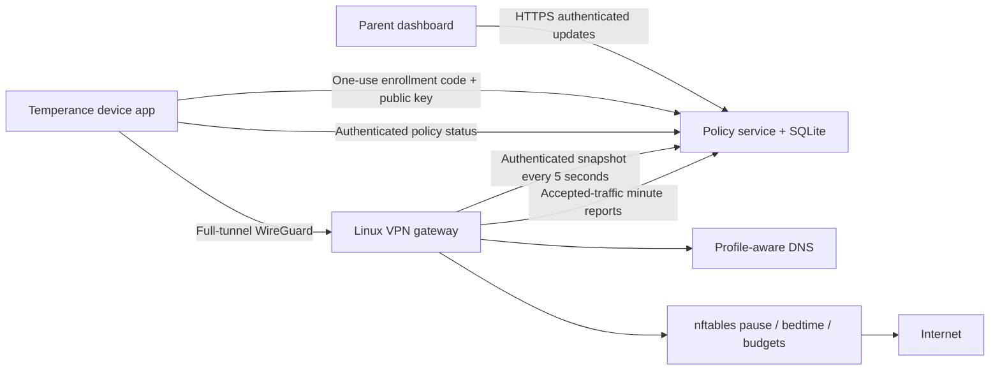

# VPN architecture and protocol



The policy service is authoritative. Clients generate private keys locally; only public keys are enrolled. An administrator creates a random enrollment code for one profile. It expires after 10 minutes and is consumed atomically with enrollment. The response contains a scoped device token, assigned tunnel addresses, gateway public key, endpoint, policy version, and current policy. Device tokens are stored as hashes at the service. Codes and keys are never embedded in repository configuration.

An instance manages one household and one WireGuard gateway, with up to 253 lifetime IPv4 assignments. Revoked addresses are not reused. Deploy separate instances for separate households. Profile/device changes increment the monotonic policy version. Device tokens only read that device's state; gateway and administrator tokens have distinct privileges. Admin browser sessions use expiring HMAC-authenticated HttpOnly/SameSite cookies. Bearer tokens support trusted admin API clients. Deploy the control plane behind HTTPS; it does not implement its own certificate issuance.

The gateway polls the authenticated state every 5 seconds, updates its DNS policies, reconciles WireGuard peers, and atomically replaces its two dedicated nftables tables. It never flushes unrelated firewall tables. Every enrolled peer receives an exact `/32` AllowedIPs association at the WireGuard server; WireGuard enforces the peer/source-IP binding. Client routes capture IPv4 and IPv6, but this gateway currently drops all IPv6 traffic. An existing host firewall can still deny traffic that Temperance permits: configure its forwarding rules deliberately.

Forwarded packets check both directions of the policy before existing-connection acceptance. Pause, bedtime, and budget exhaustion therefore stop existing forwarded connections as well as new ones. Access uses a 15-second expiring nftables lease, refreshed with policy updates. If the agent hangs, crashes, loses its policy connection, or stops, leases expire and tunnel forwarding closes. A separate bootstrap drop table closes traffic while the gateway interface initially starts. Gateway and device revocation propagate on the next successful poll.

Usage is **observed allowed network minutes**, not foreground screen time. Named nftables counters track accepted traffic in both directions. Every poll with positive counters reports its active devices; the service counts the current minute once per profile, even for simultaneous devices. A minute at a poll boundary can differ from the actual packet timestamp by several seconds. Background traffic counts. Handshakes and rejected traffic do not count. DNS-only access to the gateway is exempt from forwarding counts. At a reached budget the next reconciliation closes traffic; enforcement granularity is about five seconds. The standalone DNS mode retains its separate DNS-observed usage model.

DNS requests to any IPv4 resolver on port 53 are redirected to the gateway. Direct port 853 DNS is blocked. Domain filtering refuses queries before forwarding; starter category lists remain small. DNS over HTTPS, direct IP connections, shared CDNs, VPN/proxy overlays, and cached DNS can bypass domain/category filtering. **The implementation does not claim comprehensive web content filtering.** Pause/bedtime/budgets still deny the entire forwarded connection even in these cases. The gateway denies private/reserved destination networks and peer-to-peer access. The gateway itself permits tunnel DNS and HTTPS administration traffic. Do not host an open proxy on its HTTPS endpoint.

Network enforcement applies while devices route through this VPN. Preventing VPN removal, route changes, another VPN, and off-tunnel access requires OS-level administration: Android always-on lockdown/device owner; Apple managed-device restrictions; restricted desktop accounts and host firewall policy. The application alone cannot take ownership of an unmanaged personal device. Apple on-demand connection is automatic reconnection, not a supervised-device always-on guarantee. Linux's systemd tunnel starts at boot; Windows uses the WireGuard tunnel service. macOS/iOS use Network Extension; Android embeds the official GoBackend VPN service.

## API

All JSON writes are bounded to 64 KiB. Production URLs must use HTTPS. Clients verify the platform trust store and do not disable certificate checks.

| Method | Path | Credential | Purpose |
| --- | --- | --- | --- |
| POST | `/v1/login` | Admin token in body + matching Origin | One-hour browser session |
| GET | `/api/state` | Admin | Dashboard configuration and usage |
| POST | `/api/profiles` | Admin | Create/update policy, increment revision |
| POST | `/api/devices` | Admin | Assign/change device profile |
| POST | `/api/devices/delete` | Admin | Revoke enrolled peer and token |
| POST | `/api/enrollment` | Admin | `{profile_id}` → short-lived one-use code |
| POST | `/v1/enroll` | Enrollment code | `{code,name,public_key}` → device token/state |
| GET | `/v1/device/state` | Device bearer | Its own policy and VPN provisioning |
| GET | `/v1/gateway/state` | Gateway bearer | Policies and active peers |
| POST | `/v1/gateway/activity` | Gateway bearer | `{active_devices:[device_id]}` → minute accounting |
| GET | `/healthz` | None | Liveness only |

If an enrollment response is lost after a code was consumed, revoke the partial enrollment in the dashboard and enroll again with a fresh code/key. Clients retain VPN configuration when policy status requests fail; they never disconnect merely because a device token was revoked. Removing the corresponding peer at the gateway denies that VPN's data path. A fully revoked client must be reset locally by its administrator before enrolling again.

The service retains usage minutes for 30 days. Gateway DNS request records are in memory and are not sent to the policy service. They are lost on restart. Production distribution of compiled clients requires appropriate platform signing and should pin/test dependencies before each release. Third-party WireGuard components retain their upstream licenses; Temperance's own code is MIT.

## Verification

```sh
python3 -m unittest discover -s tests -v
(cd clients/desktop && go test -race ./...)
node --check temperance/static/app.js
node --check temperance/static/login.js
```

The Linux network integration test must run only inside its disposable Docker VM/container. It creates network namespaces, real WireGuard interfaces, and dedicated nftables rules; it never modifies the workstation's network configuration:

```sh
docker build -f deploy/Dockerfile.test -t temperance-test .
docker run --rm --privileged -v "$PWD:/workspace:ro" temperance-test
```

It verifies real encrypted forwarding, forced DNS redirection/filtering, network pause/resume, enforcement lease expiry, and peer revocation. The container requires WireGuard support in the Docker VM/Linux host kernel. Client build and CI jobs separately verify Android APK compilation, macOS/iOS unsigned builds, and desktop cross-compilation. Physical-client VPN consent, boot recovery, platform signing, and managed-device lockdown still require device acceptance testing.
